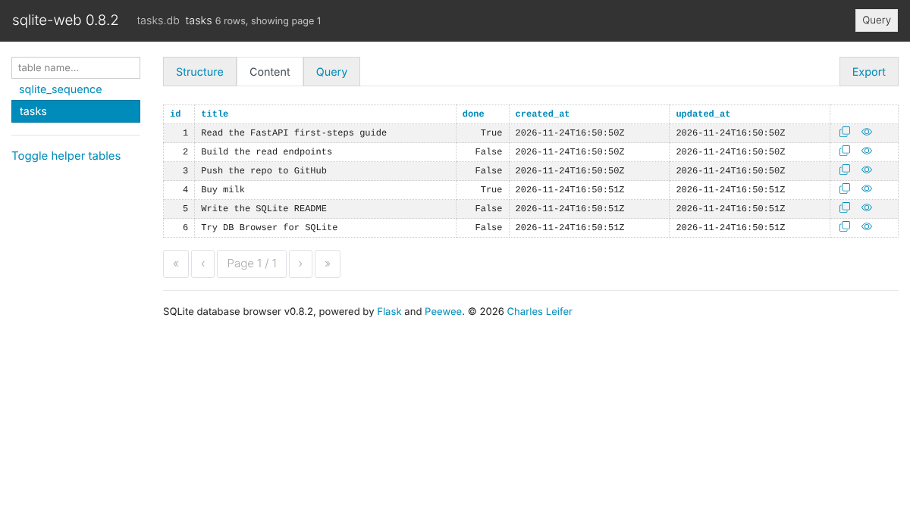

# Task API + SQLite

The same to-do CRUD API as [Assignment 1](https://github.com/MdIbuA/flyrank-task-api), but tasks are now stored in a **SQLite** database instead of a Python list. The URLs, request bodies and responses are unchanged; only the storage layer moved. The difference you can see is that **data now survives a server restart**.

Built for FlyRank's Backend AI Engineering track, assignment **A2: Connecting to the database** (Python lane: FastAPI + the standard-library `sqlite3` module).



## Run it

Requires Python 3.10+.

```bash
pip install -r requirements.txt
uvicorn main:app --reload
```

On the first start the app creates `tasks.db` next to `main.py`, creates the `tasks` table, and inserts three example tasks. Later starts find the table already filled and insert nothing. Swagger UI is at <http://localhost:8000/docs>.

Tests (11, each on its own throwaway database): `pip install -r requirements-dev.txt && pytest -q`

## Why SQLite

- **Zero setup.** No server to install or run; the whole database is one file, and Python ships with the driver (`sqlite3`).
- **Real SQL.** It's a proper relational database with tables, types, constraints and transactions, so the queries here carry over to PostgreSQL almost unchanged.
- **Right size.** One process, one user, a few thousand rows: exactly what SQLite is built for. A3 moves to Postgres when there's a reason to (several app instances, concurrent writers, a separate DB server).

## Where the data lives

`tasks.db`, in the project folder (next to `main.py`). Set the `TASKS_DB` environment variable to use a different file. The file is in `.gitignore`: the database is created on first run, so it doesn't belong in the repo.

Schema (`db.py`):

```sql
CREATE TABLE IF NOT EXISTS tasks (
    id         INTEGER PRIMARY KEY AUTOINCREMENT,
    title      TEXT    NOT NULL CHECK (length(trim(title)) > 0),
    done       BOOLEAN NOT NULL DEFAULT 0 CHECK (done IN (0, 1)),
    created_at TEXT    NOT NULL DEFAULT (strftime('%Y-%m-%dT%H:%M:%SZ', 'now')),
    updated_at TEXT    NOT NULL DEFAULT (strftime('%Y-%m-%dT%H:%M:%SZ', 'now'))
);
```

`AUTOINCREMENT` means a deleted id is never handed out again, which matches Assignment 1's behaviour.

## How the code is split

| File | Job |
|---|---|
| `main.py` | HTTP layer: routes, validation, status codes. Contains no SQL. |
| `repository.py` | `SqliteTaskRepository`: every SQL query lives here (`list_all`, `get`, `create`, `update`, `delete`, `stats`, `reset`). |
| `db.py` | Where the file is, the schema, and first-run setup. |

Routes get a repository through FastAPI's `Depends(get_repo)`, which opens one connection per request and closes it afterwards. Every query uses `?` placeholders, so user input is never pasted into SQL.

## Endpoints

Same as Assignment 1. Every task now also carries `created_at` and `updated_at`.

| Method | Path | Success | Errors |
|---|---|---|---|
| GET | `/tasks` (optional `?done=` and `?search=`) | 200 | 400 |
| GET | `/tasks/{id}` | 200 | 404, 400 |
| POST | `/tasks` | 201 | 400 |
| PUT | `/tasks/{id}` | 200 | 404, 400 |
| DELETE | `/tasks/{id}` | 204 | 404 |
| GET | `/stats` | 200 | |
| POST | `/reset` | 200 | |

## Example SQL I ran

```sql
-- Completed tasks only
SELECT * FROM tasks WHERE done = 1;
```

All five Stage 4 queries, with their output and how the API responded straight afterwards, are in [docs/sql-session.md](docs/sql-session.md). The queries are also in [queries.sql](queries.sql) so you can run them yourself in [DB Browser for SQLite](https://sqlitebrowser.org/) or any SQLite viewer.

## Proving it persists

1. Create a task: `curl -i -X POST http://localhost:8000/tasks -H "Content-Type: application/json" -d '{"title": "Buy milk"}'`
2. Stop the server (Ctrl+C) and start it again.
3. `curl http://localhost:8000/tasks`: "Buy milk" is still there, and the three example tasks were not inserted a second time.

The test suite checks both of these automatically (`test_data_survives_restart`, `test_database_file_is_created_and_seeded_once`).

## Optional extras done

- `?search=` uses SQL `LIKE`, with `%` and `_` escaped so they're matched literally.
- `?done=true` is a SQL `WHERE` clause.
- `/stats` uses `COUNT(*)` and `SUM(done)` in SQL instead of counting in Python.
- `created_at` / `updated_at` timestamps on every task.

## What I noticed

The API layer hardly changed. Each route went from touching a list to calling one repository method, and clients can't tell the difference. Writing straight to the file with SQL showed up in the API immediately, because the API holds no copy of the data anymore; the database is the single source of truth.
